<div align="center">


<a href="https://github.com/ALRO-GM">
  
</a>

<br/>

<a href="https://peer4u.app"></a>
<a href="mailto:ajrd91@gmail.com"></a>


</div>

---

### 👨‍💻 About me

```ts
const alberto = {
  location:  "Madrid, Spain 🇪🇸",
  school:    "42 Madrid",
  focus:     ["Full-stack web", "Local LLMs & RAG", "WebAR / 3D"],
  stack:     ["TypeScript", "React", "Node.js", "Python", "SQLite"],
  shipping:  "peer4u.app — find a peer who can help you, right now",
  openTo:    ["Internships", "Junior roles", "Collaborations"],
};
```

### 🚀 Featured projects

<table>
<tr>
<td width="50%" valign="top">

#### 🤝 [Peer4U](https://github.com/ALRO-GM/sanatorio-42)
Tells a 42 student **who can help them with their project right now, and where they are sitting**. In production with 42 OAuth login and a public demo.

`TypeScript` `React 19` `Fastify` `SQLite` `Docker` `Vitest`

[**Live →**](https://peer4u.app) · [**Demo →**](https://peer4u.app/demo/)

</td>
<td width="50%" valign="top">

#### ⚗️ [Labtory](https://github.com/ALRO-GM/WebAR)
Chemistry lab in **augmented reality from the browser**: point the camera at printed atom cards and watch them react into 50 molecules. Installable PWA, built at a hackathon.

`TypeScript` `Three.js` `WebAR` `PWA` `Vite`

[**Live →**](https://labtory.peer4u.app)

</td>
</tr>
<tr>
<td width="50%" valign="top">

#### 🔎 [RAG against the machine](https://github.com/ALRO-GM/RAG)
Retrieval-Augmented Generation over the vLLM codebase: hybrid **BM25 + semantic** retrieval, grounded answers from Qwen3 running locally on CPU, recall@k evaluation and an experiment lab.

`Python` `Transformers` `Sentence-Transformers` `FastAPI`

</td>
<td width="50%" valign="top">

#### 📞 [call me maybe](https://github.com/ALRO-GM/IA_call_me_maybe)
Turns plain-English requests into **function calls as valid JSON, 100% of the time**, using a tiny 0.6B model plus constrained decoding.

`Python` `Qwen3-0.6B` `Constrained decoding` `LLM tooling`

</td>
</tr>
</table>

### 🛠️ Tech stack

<div align="center">


<br/>

<br/>


</div>

### 📊 GitHub stats

<div align="center">



<br/>


<picture>
  <source media="(prefers-color-scheme: dark)" srcset="https://raw.githubusercontent.com/ALRO-GM/ALRO-GM/output/github-contribution-grid-snake-dark.svg" />
  <source media="(prefers-color-scheme: light)" srcset="https://raw.githubusercontent.com/ALRO-GM/ALRO-GM/output/github-contribution-grid-snake.svg" />
  
</picture>

</div>


