<a href="https://github.com/ALRO-GM">
  <picture>
    <source media="(prefers-color-scheme: dark)" srcset="https://raw.githubusercontent.com/ALRO-GM/ALRO-GM/output/card-dark.svg" />
    <source media="(prefers-color-scheme: light)" srcset="https://raw.githubusercontent.com/ALRO-GM/ALRO-GM/output/card-light.svg" />
    
  </picture>
</a>

 

> **I don't wait for a ticket.** When I see people losing time on a problem, I design the fix, build it end-to-end, put it in production and keep it running — product, design, code, infra and support. Below is the proof.

 

## 🚀 Flagship · [Peer4U](https://github.com/ALRO-GM/sanatorio-42) — built, launched and operated solo

<table>
<tr>
<td width="44%" valign="top">

**The problem.** 42 has no teachers: you learn by asking the student next to you. But *who* can help you right now — and where are they sitting?

**What I did.** Turned 42's own data into a live product that answers that in one click, then built everything around it so help actually happens: on-call shifts, group sprints, whiteboards, campus maps, courses and a calendar.

**How it runs.** Solo, from idea to production: product, UX, API, database, deploy and on-call. Ships changes almost daily, behind a CI that blocks any red build.

<a href="https://peer4u.app"><b>Open the app →</b></a> &nbsp;·&nbsp; <a href="https://peer4u.app/demo/"><b>Try the demo (no account) →</b></a>

</td>
<td width="56%" valign="top">

</td>
</tr>
</table>

 

## 🧪 More things I've shipped

<table>
<tr>
<td width="33%" valign="top">

### ⚗️ [Labtory](https://github.com/ALRO-GM/WebAR)
`Hackathon` · `WebAR` · `Three.js` · `PWA`

**Problem:** chemistry is abstract and AR usually needs an app install.
**Shipped:** point your phone at printed atom cards and watch them react — **118 elements, 50 molecules, 38 reactions**, right in the browser.

[**Live →**](https://labtory.peer4u.app)

</td>
<td width="33%" valign="top">

### 🔎 [RAG against the machine](https://github.com/ALRO-GM/RAG)
`Python` · `Local LLM` · `Hybrid search`

**Problem:** answering questions about a huge codebase (vLLM) with a tiny CPU model.
**Shipped:** hybrid BM25 + semantic retrieval with cited answers, and an **experiment lab** that tunes every setting with cross-validation instead of guessing.

</td>
<td width="33%" valign="top">

### 📞 [call me maybe](https://github.com/ALRO-GM/IA_call_me_maybe)
`Python` · `Qwen3-0.6B` · `Constrained decoding`

**Problem:** small LLMs produce broken JSON for function calling.
**Shipped:** a 0.6B model that turns plain English into function calls with **100% valid JSON**, guaranteed by constrained decoding.

</td>
</tr>
</table>

 

## 🧭 How I work

<table>
<tr>
<td width="50%" valign="top">

**⚡ Bias for action** 
I build the smallest thing that solves the real problem, put it in front of users and iterate. Peer4U's changelog moves almost every day.

</td>
<td width="50%" valign="top">

**📏 Measure before claiming** 
Every number I publish says whether it's measured, calculated or estimated — and when. RAG's defaults come from experiments, not hunches.

</td>
</tr>
<tr>
<td width="50%" valign="top">

**🧱 Turn constraints into design** 
42's API allows 1,200 requests/hour for the whole app. So Peer4U mirrors the data incrementally and never calls 42 to render a page.

</td>
<td width="50%" valign="top">

**🛡️ Own it in production** 
One-command deploys that wait for CI and roll back on their own, verified backups, and a guard that shuts things down before spending a cent.

</td>
</tr>
</table>

 

## 🛠️ Toolbox

 

## 📈 Activity

<picture>
  <source media="(prefers-color-scheme: dark)" srcset="https://raw.githubusercontent.com/ALRO-GM/ALRO-GM/output/github-contribution-grid-snake-dark.svg" />
  <source media="(prefers-color-scheme: light)" srcset="https://raw.githubusercontent.com/ALRO-GM/ALRO-GM/output/github-contribution-grid-snake.svg" />
  
</picture>

  

**Got a problem worth solving?** I'm open to internships, junior roles and side projects with ambitious teams. 
<a href="mailto:ajrd91@gmail.com"><b>ajrd91@gmail.com</b></a> · <a href="https://peer4u.app"><b>peer4u.app</b></a>

